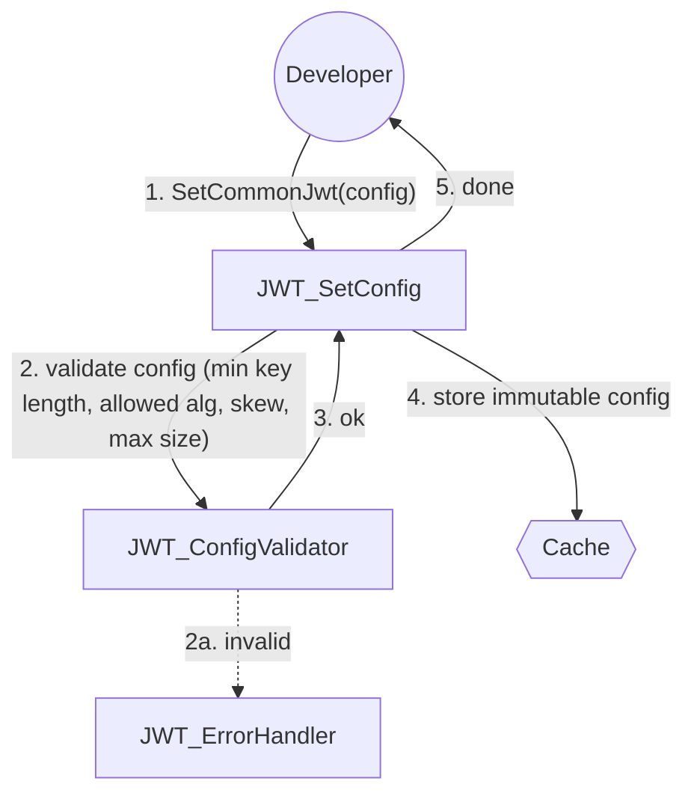
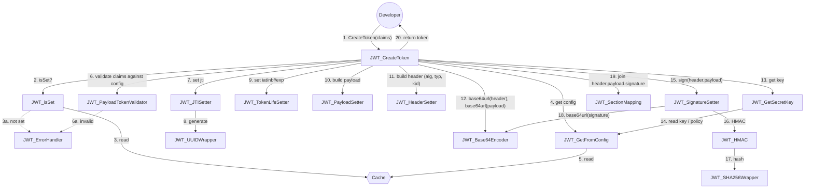
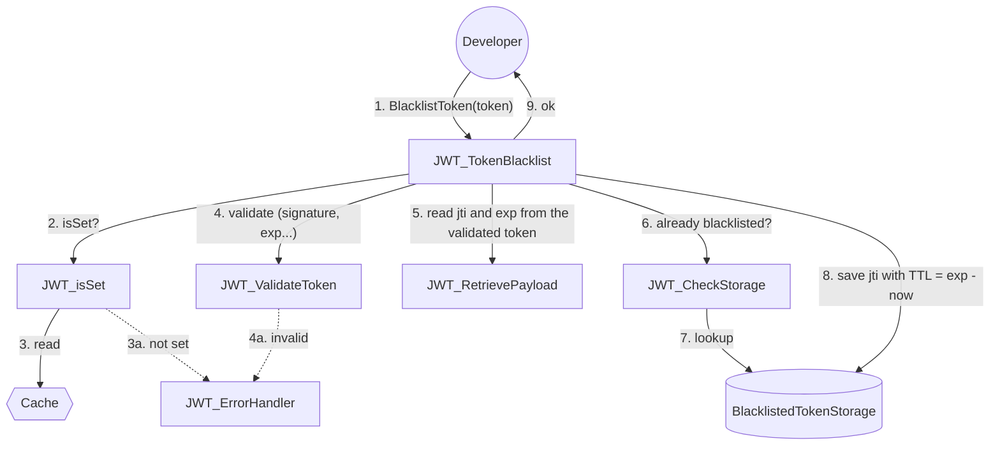
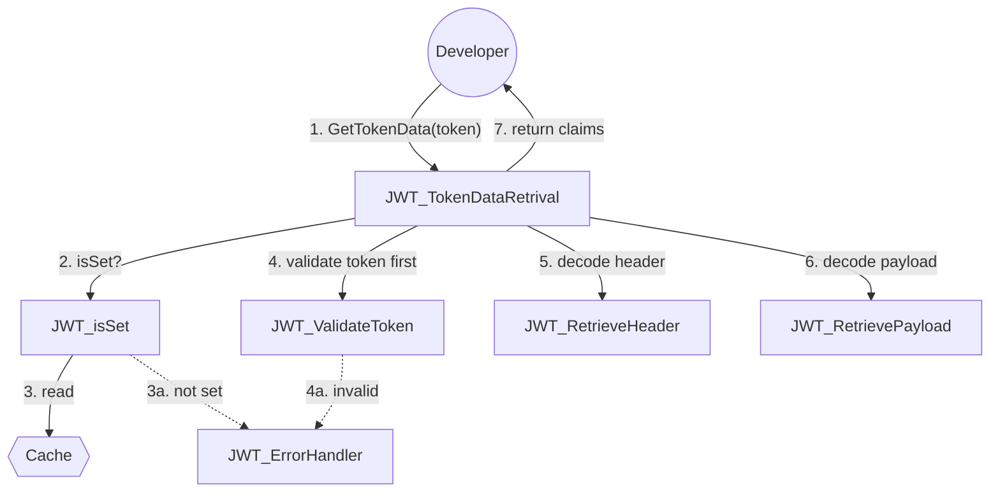

# User Stories Grouping:

## Issues JWT:
-  As a developer, I want to choose the signing algorithm (e.g., HS256, RS256, ES256) so that I can match my security requirements.
- As a developer, I want the library to automatically build the header (alg, typ) so that I don’t have to construct it manually.

## Cofig:
-  As a developer, I want to choose the signing algorithm (e.g., HS256) so that I can match my security requirements.
- As a developer, I want to set standard claims (sub, iss, aud, iat, nbf, exp, jti) so that tokens follow RFC 7519.
- As a developer, I want to set a token lifetime (e.g., 15 minutes) so that stolen tokens expire quickly.
- As a developer, I want to enforce a minimum key length for HMAC secrets so that weak keys are rejected.

## Token Validation: 
- As a developer, I want to verify a token’s signature so that I can confirm it was issued by my server and not tampered with.
- As a developer, I want the signature comparison to be constant-time so that timing attacks are not possible.
- As a developer, I want verification to reject expired tokens so that old tokens cannot be reused.
- As a developer, I want verification to reject tokens used before their nbf time so that not-yet-valid tokens are denied.
- As a developer, I want to validate iss and aud against expected values so that tokens meant for other systems are rejected.
- As a developer, I want to pin the allowed algorithms during verification so that algorithm-substitution attacks are prevented.
- As a developer, I want the library to always reject alg: none tokens so that unsigned tokens are never accepted.???
- As a developer, I want to configure clock skew tolerance so that small time differences between servers don’t cause false rejections.
- As a developer, I want to manipulate the maximum payload size to avoid extensive time encoding errors.
- As a developer, I expect lib to handle multiple iss and aud values.
- As a developer, I want to choose a key management policy (static key, rolling key,) so that I can match the library to my deployment and security needs.
- As a developer, I want to provide a static key from configuration so that I can get started quickly with a simple setup.
- As a developer, I want to automaticall generate UUID for JTI
- As a developer, I want to configure a maximum token size (default e.g. 8 KB) so that oversized tokens are rejected before parsing and cannot be used for denial-of-service attacks.

### Token Blacklist:
- As a developer, I want a hook or blacklist check (by jti) so that I can revoke specific tokens before they expire.

## Token Data Retrival:
- As a developer, I want to decode a token and read its claims after successful verification so that I can use the user ID and roles.

## Error Handling:
- As a developer, I want clear, typed errors (invalid signature, expired, malformed, wrong audience) so that I can respond with proper HTTP status codes.
- As a developer, I want malformed tokens (wrong number of parts, invalid Base64URL or JSON) to fail safely without throwing unhandled exceptions.

## Token Rotation:
- As a developer, I want to support key rotation via a key ID (kid) header so that I can replace keys without invalidating all tokens at once.
- As a developer, I want the library to automatically generate and rotate signing keys at a configurable interval so that I get key rotation without manual work.
- As a developer, I want retired rolling keys to remain valid for verification until all tokens signed with them have expired so that rotation does not log out users.

## Docs:
- As a developer, I want a simple, well-documented API with sensible secure defaults so that I can use it correctly without deep cryptography knowledge.

## 0. SetConfig

## 1. CreateToken

## 2. ValidateToken

```mermaid
flowchart TD
    User((Developer))
    Cache{{Cache}}
    Storage[(BlacklistedTokenStorage)]

    User -->|"1. ValidateToken(token)"| JWT_ValidateToken
    JWT_ValidateToken -->|"2. isSet?"| JWT_isSet
    JWT_isSet -->|"3. read"| Cache
    JWT_isSet -.->|"3a. not set"| JWT_ErrorHandler

    JWT_ValidateToken -->|"4. get config"| JWT_GetFromConfig
    JWT_GetFromConfig -->|"5. read"| Cache

    JWT_ValidateToken -->|"6. size limit (before parsing)"| JWT_TokenSizeThresholdValidator
    JWT_TokenSizeThresholdValidator -->|"6b. DoS check"| JWT_PayloadSizeDOSPrev
    JWT_TokenSizeThresholdValidator -.->|"6a. too large"| JWT_ErrorHandler

    JWT_ValidateToken -->|"7. split into 3 parts, decode"| JWT_InoputPayloadValidator
    JWT_InoputPayloadValidator -.->|"7a. malformed"| JWT_ErrorHandler

    JWT_ValidateToken -->|"8. alg on allowed list, not none"| JWT_AlgorithmValidator
    JWT_AlgorithmValidator -->|"8b. alg matches key"| JWT_SigningAlgorithValidator
    JWT_AlgorithmValidator -.->|"8a. not allowed"| JWT_ErrorHandler

    JWT_ValidateToken -->|"9. select key by kid"| JWT_KeyManagementPolicyValidator
    JWT_KeyManagementPolicyValidator -.->|"9a. unknown kid"| JWT_ErrorHandler

    JWT_ValidateToken -->|"10. verify signature"| JWT_SignatureValidator
    JWT_SignatureValidator -->|"11. constant-time compare"| JWT_UnifiedClockStringCompare
    JWT_SignatureValidator -.->|"10a. invalid"| JWT_ErrorHandler

    JWT_ValidateToken -->|"12. time checks"| JWT_TokenLifeValidator
    JWT_TokenLifeValidator -->|"13. nbf"| JWT_nbfValidator
    JWT_TokenLifeValidator -->|"14. exp"| JWT_expValidator
    JWT_nbfValidator -->|"15. apply skew"| JWT_SkewToleranceLayer
    JWT_expValidator -->|"15. apply skew"| JWT_SkewToleranceLayer
    JWT_TokenLifeValidator -.->|"12a. expired / not yet valid"| JWT_ErrorHandler

    JWT_ValidateToken -->|"16. iss / aud"| JWT_IssValidator
    JWT_IssValidator -->|"17. expected values from config"| JWT_FetchProvidedIss
    JWT_IssValidator -.->|"16a. mismatch"| JWT_ErrorHandler

    JWT_ValidateToken -->|"18. revoked?"| JWT_JtiBlacklistTokenValidator
    JWT_JtiBlacklistTokenValidator -->|"19. lookup jti"| Storage
    JWT_JtiBlacklistTokenValidator -.->|"18a. revoked"| JWT_ErrorHandler

    JWT_ValidateToken -->|"20. valid / error"| User
```

## 3. TokenBlacklist (logout)

## 4. TokenDataRetrival

